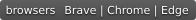
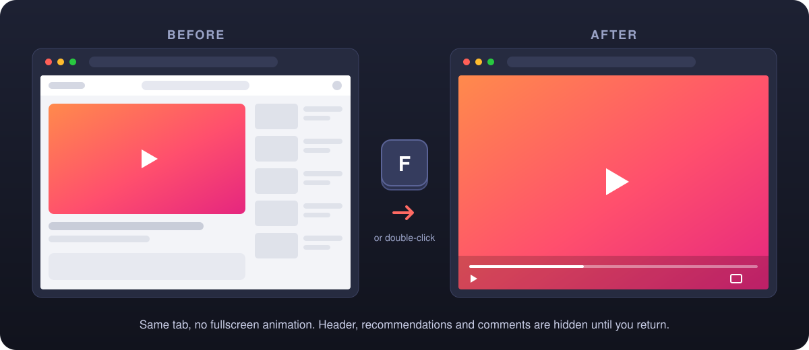

<p align="center">
  
</p>

<h1 align="center">YouTube In-Page Fullscreen</h1>

<p align="center">
  Expand YouTube videos to fill the browser page, in the same tab.<br>
  No macOS fullscreen animation, no new Space, nothing to configure.
</p>

<p align="center">
  <a href="https://github.com/IGOLz/youtube-in-page-fullscreen/releases/latest"></a>
  <a href="https://github.com/IGOLz/youtube-in-page-fullscreen/actions/workflows/test.yml"></a>
  
  
  <a href="LICENSE"></a>
</p>

<p align="center">
  
</p>

## About

On macOS, YouTube's native fullscreen moves the browser into a new Space. Leaving it plays a slow sliding animation. This extension adds an in-page mode instead: the player covers the entire page area of the current tab and everything else on the page is hidden until you return. Entering and leaving are instant.

Combine it with the browser's own fullscreen (<kbd>Ctrl</kbd> <kbd>⌘</kbd> <kbd>F</kbd>) to get a true full-screen video that you can shrink back to the page without any macOS transition.

> [!NOTE]
> This is an independent open-source project. It is not affiliated with, endorsed by or sponsored by YouTube or Google.

## Features

| | |
| --- | --- |
| ⚡ **Instant** | Expands and restores without animation, in the same tab |
| ⌨️ **Keyboard first** | <kbd>F</kbd> toggles, <kbd>Esc</kbd> returns. Ignored while you type in search or comments |
| 🖱️ **Mouse friendly** | Double-click the video, or use the new button next to YouTube's fullscreen button |
| 🧹 **Distraction free** | Header, playlist, recommendations, description and comments are hidden while expanded |
| 🎛️ **Native controls** | Playback, captions, settings and the original fullscreen button keep working |
| ↩️ **Restores your place** | Scroll position and keyboard focus come back when you exit |
| 🔒 **Private by design** | No permissions, no network requests, no analytics, no stored data |
| 🌍 **Localized** | English and Italian |

## Installation

The extension is not on the Chrome Web Store yet. It installs in a minute as an unpacked extension in Brave, Chrome, Edge, Arc, Vivaldi or any other Chromium browser.

1. Download `youtube-in-page-fullscreen-vX.Y.Z.zip` from the [latest release](https://github.com/IGOLz/youtube-in-page-fullscreen/releases/latest) and unzip it.
2. Open the extensions page: `brave://extensions`, `chrome://extensions` or `edge://extensions`.
3. Turn on **Developer mode**.
4. Click **Load unpacked** and select the unzipped folder, the one that contains `manifest.json`.
5. Reload any YouTube tabs that were already open.

Keep the folder where it is: the browser loads the extension from there.

**Updating:** replace the folder contents with the new release, click the reload button on the extension card, then reload YouTube.

**From source:** clone the repository and load the `extension/` folder. It runs as-is, with no build step.

## Usage

Open any video on `youtube.com/watch`.

| Action | Result |
| --- | --- |
| <kbd>F</kbd> | Fill the page, or return to it |
| Double-click the video | Fill the page, or return to it |
| New window-shaped button in the player bar | Fill the page, or return to it |
| <kbd>Esc</kbd> | Return to the page |
| YouTube's original fullscreen button | Native fullscreen, as before |

Navigating to another video, or YouTube moving the player into the miniplayer, returns to the normal page automatically.

## Limitations

- In-page mode fills the **page area**. The browser's tabs and address bar stay visible unless the browser itself is in fullscreen.
- Only regular `www.youtube.com/watch` pages. Shorts, embedded players and YouTube Music are not supported.
- YouTube changes its markup from time to time. If something breaks, please [open an issue](https://github.com/IGOLz/youtube-in-page-fullscreen/issues/new?template=bug_report.yml).

## Privacy

The extension is one content script and one stylesheet, built on Manifest V3. It requests no permissions and only runs on `https://www.youtube.com/*`, including the home page so it can follow YouTube's in-app navigation to a video. It has no background worker, popup, analytics or network access, and it stores nothing. It does not touch ads or Brave Shields.

## Development

```text
extension/      the extension, loaded as-is by the browser
  _locales/     English and Italian strings
tests/          end-to-end tests with Playwright
assets/         logo and README artwork (SVG sources)
```

Run the tests with Playwright's Chromium:

```sh
npm ci
npx playwright install chromium
npm test
```

Or with an installed browser, using a temporary profile that never touches your own:

```sh
BROWSER_PATH='/Applications/Brave Browser.app/Contents/MacOS/Brave Browser' npm test
```

The tests load the unpacked extension on a fixture page served at a YouTube URL. They cover player size, window resizing, shortcuts, text fields, focus, scroll, native fullscreen, navigation and player replacement. Real playback, ads and the live YouTube layout still need a quick manual check.

**Releasing:** bump `version` in `extension/manifest.json` and `package.json`, then push a `vX.Y.Z` tag. GitHub Actions packages `extension/` and publishes the release.

## Contributing

Bug reports and pull requests are welcome. For a change in behavior, open an issue first to discuss it. Please keep the extension dependency-free and permission-free, and add or update a test in `tests/` for anything you fix.

## Acknowledgements

The idea comes from [ibnuh/youtube-full-screen-tab](https://github.com/ibnuh/youtube-full-screen-tab). This implementation is written from scratch: <kbd>F</kbd> goes straight to in-page mode, with no popup or settings, and YouTube's native fullscreen button stays available.

## License

[MIT](LICENSE) © IGOLz
