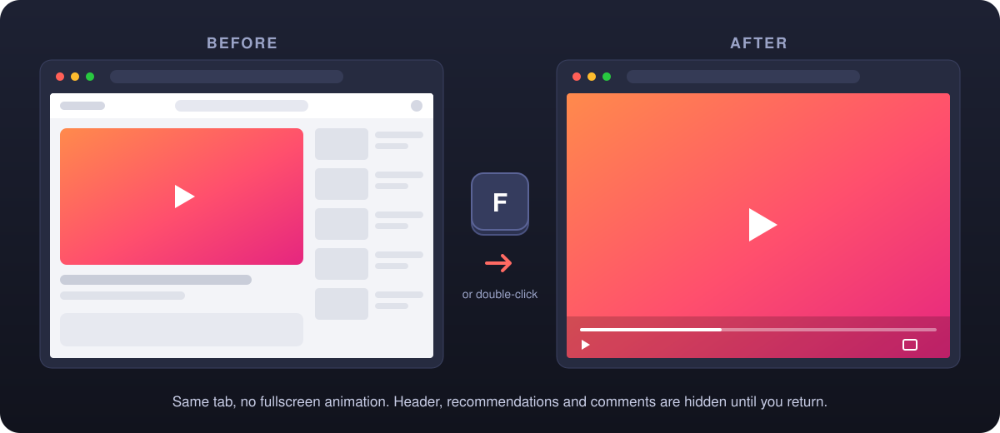

<p align="center">
  
</p>

<h1 align="center">YouTube In-Page Fullscreen</h1>

<p align="center">
  Espandi i video di YouTube a tutta pagina, nella stessa scheda.<br>
  Nessuna animazione del tutto schermo di macOS, nessuno Spazio nuovo, niente da configurare.
</p>

<p align="center">
  <a href="https://github.com/IGOLz/youtube-in-page-fullscreen/releases/latest"></a>
  <a href="https://github.com/IGOLz/youtube-in-page-fullscreen/actions/workflows/test.yml"></a>
  
  <a href="../LICENSE"></a>
</p>

<p align="center">
  <a href="../README.md">English</a> · <b>Italiano</b>
</p>

<p align="center">
  
</p>

## Cos'è

Su macOS il tutto schermo nativo di YouTube sposta il browser in un nuovo Spazio e, all'uscita, riproduce una lenta animazione laterale. Questa estensione aggiunge invece una modalità a tutta pagina: il player copre l'intera area della scheda corrente e il resto della pagina resta nascosto finché non torni indietro. Entrata e uscita sono immediate.

Abbinala al tutto schermo del browser (<kbd>Ctrl</kbd> <kbd>⌘</kbd> <kbd>F</kbd>) per avere un video davvero a schermo intero che puoi ridurre alla pagina senza alcuna transizione di macOS.

> [!NOTE]
> Progetto open source indipendente. Non è affiliato, approvato o sponsorizzato da YouTube o Google.

## Funzionalità

| | |
| --- | --- |
| ⚡ **Immediata** | Espande e ripristina senza animazioni, nella stessa scheda |
| ⌨️ **Da tastiera** | <kbd>F</kbd> alterna, <kbd>Esc</kbd> torna alla pagina. Ignorati mentre scrivi nella ricerca o nei commenti |
| 🖱️ **Anche col mouse** | Doppio clic sul video, oppure il nuovo pulsante accanto al tutto schermo di YouTube |
| 🧹 **Senza distrazioni** | Intestazione, playlist, consigli, descrizione e commenti nascosti durante la vista espansa |
| 🎛️ **Controlli originali** | Riproduzione, sottotitoli, impostazioni e pulsante tutto schermo nativo continuano a funzionare |
| ↩️ **Riprendi da dove eri** | Scorrimento e focus della tastiera ripristinati all'uscita |
| 🔒 **Privacy** | Nessun permesso, nessuna richiesta di rete, nessuna statistica, nessun dato salvato |
| 🌍 **Tradotta** | Inglese e italiano |

## Installazione

L'estensione non è ancora sul Chrome Web Store. Si installa in un minuto come estensione non pacchettizzata in Brave, Chrome, Edge, Arc, Vivaldi o qualsiasi altro browser Chromium.

1. Scarica `youtube-in-page-fullscreen-vX.Y.Z.zip` dall'[ultima release](https://github.com/IGOLz/youtube-in-page-fullscreen/releases/latest) ed estrailo.
2. Apri la pagina delle estensioni: `brave://extensions`, `chrome://extensions` o `edge://extensions`.
3. Attiva **Modalità sviluppatore**.
4. Premi **Carica estensione non pacchettizzata** e seleziona la cartella estratta, quella che contiene `manifest.json`.
5. Ricarica le schede YouTube già aperte.

Lascia la cartella dove si trova: il browser carica l'estensione da lì.

**Aggiornamento:** sostituisci il contenuto della cartella con la nuova release, premi il pulsante di ricarica sulla scheda dell'estensione, poi ricarica YouTube.

**Dal codice sorgente:** clona il repository e carica la cartella `extension/`. Funziona così com'è, senza compilazione.

## Uso

Apri un qualsiasi video su `youtube.com/watch`.

| Comando | Risultato |
| --- | --- |
| <kbd>F</kbd> | Riempie la pagina o torna indietro |
| Doppio clic sul video | Riempie la pagina o torna indietro |
| Nuovo pulsante a forma di finestra nella barra del player | Riempie la pagina o torna indietro |
| <kbd>Esc</kbd> | Torna alla pagina |
| Pulsante tutto schermo originale di YouTube | Tutto schermo nativo, come prima |

Passare a un altro video, o lo spostamento del player nel miniplayer, riporta automaticamente alla pagina normale.

## Limiti

- La modalità riempie l'**area della pagina**. Schede e barra degli indirizzi restano visibili, a meno che il browser stesso non sia a tutto schermo.
- Solo le normali pagine `www.youtube.com/watch`. Shorts, player incorporati e YouTube Music non sono supportati.
- YouTube cambia la sua struttura di tanto in tanto. Se qualcosa smette di funzionare, [apri una segnalazione](https://github.com/IGOLz/youtube-in-page-fullscreen/issues/new?template=bug_report.yml).

## Privacy

L'estensione è un content script e un foglio di stile, basati su Manifest V3. Non richiede permessi e funziona solo su `https://www.youtube.com/*`, home compresa, per seguire la navigazione interna di YouTube verso un video. Non ha background worker, popup, statistiche o accesso alla rete, e non salva nulla. Non interviene su annunci o Brave Shields.

## Sviluppo

```text
extension/      l'estensione, caricata dal browser così com'è
  _locales/     testi in inglese e italiano
tests/          test end-to-end con Playwright
assets/         logo e grafiche del README (sorgenti SVG)
```

Esegui i test con il Chromium di Playwright:

```sh
npm ci
npx playwright install chromium
npm test
```

Oppure con un browser installato, usando un profilo temporaneo separato dal tuo:

```sh
BROWSER_PATH='/Applications/Brave Browser.app/Contents/MacOS/Brave Browser' npm test
```

I test caricano l'estensione non pacchettizzata su una pagina di prova servita a un indirizzo YouTube. Verificano dimensioni del player, ridimensionamento della finestra, scorciatoie, campi di testo, focus, scorrimento, tutto schermo nativo, navigazione e sostituzione del player. Riproduzione reale, annunci e layout attuale di YouTube richiedono comunque una breve prova manuale.

**Pubblicare una versione:** aggiorna `version` in `extension/manifest.json` e `package.json`, poi pubblica un tag `vX.Y.Z`. GitHub Actions crea il pacchetto di `extension/` e la release.

## Contribuire

Segnalazioni e pull request sono benvenute. Per cambiare un comportamento, apri prima una issue per discuterne. L'estensione deve restare senza dipendenze e senza permessi; aggiungi o aggiorna un test in `tests/` per ogni correzione.

## Ringraziamenti

L'idea nasce da [ibnuh/youtube-full-screen-tab](https://github.com/ibnuh/youtube-full-screen-tab). Questa implementazione è scritta da zero: <kbd>F</kbd> passa direttamente alla modalità a tutta pagina, senza popup o impostazioni, e il pulsante tutto schermo nativo di YouTube resta disponibile.

## Licenza

[MIT](../LICENSE) © IGOLz
